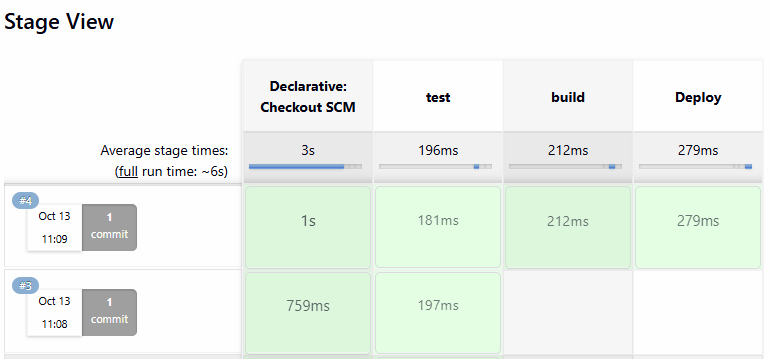

# CI Pipeline with Jenkinsfile: Freestyle, Pipeline, Multibranch

Hands-on follow-along project from Module 8 of the DevOps Bootcamp. Builds on `01-install-jenkins-on-digitalocean`; configures the build tools, Docker access and credentials that server needs, then builds the same CI workflow three times: as a freestyle job, as a pipeline job, and as a multibranch pipeline.

## Overview

The application is the bootcamp's Java Maven demo app (Spring Boot, Java 17), in my own GitHub repository. The CI workflow is the same throughout: check out the code, build the JAR with Maven, build a Docker image from it, and push that image to my public Docker Hub repository `giovannidevs/demo-app`.

What changes is how that workflow is expressed. A freestyle job configures each step through the UI. A pipeline job moves the same steps into a `Jenkinsfile` committed next to the code. A multibranch pipeline then runs that Jenkinsfile for every branch in the repository, with conditional logic so only the main branch builds and deploys while all other branches just run tests.

## Project objectives

- Make Maven available to all Jenkins jobs through the Tools configuration
- Make Docker commands usable from inside the Jenkins container
- Store GitHub and Docker Hub credentials in Jenkins and reference them by ID
- Create a freestyle job connected to the Git repository
- Replace it with a pipeline job driven by a `Jenkinsfile` from SCM
- Convert that into a multibranch pipeline with branch-dependent behaviour

## Technologies used

Jenkins, Groovy, Docker, Docker Hub, Git and GitHub, Java 17, Maven, Linux

## Prerequisites

The Jenkins server from project 01, running as a container on a DigitalOcean droplet with the `jenkins-home` volume attached.

## Implementation

### 1. Install build tools in Jenkins

Jobs cannot run `mvn` unless Maven exists on the server. Jenkins offers two routes, and both were used in this module:

- **Through a plugin.** Manage Jenkins → Tools lists Git, JDK, Gradle and Maven. A Maven installation was added under the name `maven-3.9`, and Jenkins downloads and installs that version itself. The name matters: it is the exact string a Jenkinsfile must use in its `tools` block.
- **Directly inside the container.** Entering the container as root with `docker exec -u 0 -it <container-id> bash` and installing the tool with the distribution's package manager. The Jenkins image is Debian based, checked with `cat /etc/issue`.

The **Stage View** plugin was also installed, from Manage Jenkins → Plugins → Available. It draws each pipeline stage as a column in the job page, which makes a failing stage obvious at a glance. Because Jenkins runs in Docker, "install with restart" does not restart it, so the container has to be started again from the host:

```bash
docker ps -a
docker start <container-id>
```

### 2. Make Docker available inside Jenkins

The pipeline has to build and push images, so the Jenkins container needs a Docker client and access to a Docker daemon. Rather than running a second daemon inside the container, the host's Docker runtime directory is mounted into it. The container was removed and recreated, keeping the same `jenkins-home` volume so no configuration was lost:

```bash
docker run -p 8080:8080 -p 50000:50000 -d \
  -v jenkins-home:/var/jenkins_home \
  -v /var/run/docker:/var/run/docker \
  jenkins/jenkins:latest
```

The Docker client tools were then installed inside the container, as root:

```bash
docker exec -u 0 -it <container-id> bash
curl http://get.docker.com/ > dockerinstall && chmod 777 dockerinstall && ./dockerinstall
chmod 666 /var/run/docker/docker.sock
```

The `chmod 666` on the socket is what lets the non-root `jenkins` user run `docker build` and `docker push` from a job. It is also the step that breaks later: restarting the Docker daemon on the host resets the socket permissions **and** stops every container including Jenkins, so after any daemon restart both the container start and the `chmod` have to be repeated.

### 3. Create credentials

Two global username-and-password credentials were created under Manage Jenkins → Credentials:

| ID                      | Used for                                |
| ----------------------- | --------------------------------------- |
| `dockerhub-credentials` | Logging in to Docker Hub to push images |
| `gitlab-credentials`    | Cloning from and pushing to GitHub      |

The second ID is a misnomer: it was named after the lecture, which uses GitLab, but it holds my **GitHub** username and personal access token. The ID is only a reference handle, so the pipeline works either way, but it is the kind of naming mistake worth avoiding, because the ID is what every Jenkinsfile in the repository has to quote.

Jenkins offers three credential scopes: _system_ (visible only to the Jenkins server, never to jobs), _global_ (visible everywhere), and _project_ scope, which exists only in multibranch pipelines and comes from the folder plugin. Project scope is how two teams sharing one Jenkins instance keep their credentials hidden from each other. Both credentials here are global.

### 4. Freestyle job

A freestyle job was created to see the basics work:

- **Execute shell** running `npm --version`, later moved into `freestyle-build.sh` in the repository so the job executes a script from the checked-out code rather than an inline command
- **Invoke top-level Maven targets** running `mvn --version` through the Maven plugin
- **Source Code Management** pointing at the Git repository with the credentials above, and a branch to build

When a job with SCM configured runs, Jenkins checks the repository out first and then runs the build steps against it. The checkout lives under `/var/jenkins_home/workspace/<job-name>`, with a `workspace/@tmp` folder for the job's temporary data.

The difference between the two build steps is the point of the exercise. A tool installed in the container is just a command, usable anywhere in a shell step. A tool installed as a plugin is only reachable through whatever input fields the plugin author provided. Shell steps are more flexible, and that is the direction the rest of the module takes.

Freestyle jobs execute one step each. Before pipelines existed, a full workflow meant chaining several of them through _Post build actions → Build other projects_: build the JAR, then trigger the image build, then trigger the push. Maintaining six or seven linked jobs, and updating all of them to change one tool, is exactly the problem pipelines solve.

### 5. Pipeline job with a Jenkinsfile

A pipeline job was created using **Pipeline script from SCM**, rather than pasting the script into the UI. The script then lives in the repository, versioned with the code, which is the infrastructure-as-code argument applied to CI. Jenkins looks for a file named `Jenkinsfile` in the repository root by default.

The pipeline is written in declarative syntax, the newer of the two Groovy styles. It has a fixed structure, as opposed to scripted pipelines, which are free-form Groovy. `agent any` runs the build on any available executor, and each `stage` holds a `steps` block. Jenkins adds its own _Declarative: Checkout SCM_ stage at the start automatically.

Maven is made available to all stages with the `tools` block, using the exact name configured in step 1:

```groovy
tools {
    maven 'maven-3.9'
}
```

Credentials are read with the `withCredentials` wrapper, which binds a stored credential to two variables for the duration of a block:

```groovy
withCredentials([usernamePassword(credentialsId: 'dockerhub-credentials',
                                  usernameVariable: 'USER',
                                  passwordVariable: 'PASS')]) {
    sh 'echo $PASS | docker login -u $USER --password-stdin'
    sh 'docker push giovannidevs/demo-app:jma-1.0'
}
```

The password is piped in through `--password-stdin` instead of being passed as `-p`, so it never appears in a process listing or a build log.

As the pipeline grew, the logic was pulled out of the Jenkinsfile into `script.groovy` in the same repository, loaded in an `init` stage:

```groovy
def gv

pipeline {
    agent any
    tools { maven 'maven-3.9' }
    stages {
        stage('init') {
            steps { script { gv = load 'script.groovy' } }
        }
        stage('build jar') {
            steps { script { gv.buildJar() } }
        }
    }
}
```

`gv` is declared outside the `pipeline` block so every stage can reach it, and `script.groovy` ends with `return this`, without which the file cannot be loaded. Environment variables and parameters from the Jenkinsfile are available inside the loaded script without any extra wiring.

### 6. Multibranch pipeline

A multibranch pipeline job was created last. It takes a repository rather than a branch, scans it, and creates a child pipeline for every branch that matches the configured pattern **and** contains a Jenkinsfile. Branch discovery was configured with a filter matching all branches, so a new feature branch gets a pipeline as soon as the next scan runs, with no manual job creation.

Multibranch jobs expose the `BRANCH_NAME` environment variable, which regular pipeline jobs do not. That is what makes one shared Jenkinsfile behave differently per branch:

```groovy
stage('build') {
    when {
        expression {
            BRANCH_NAME == "main"
        }
    }
    steps {
        script {
            echo 'Building the application...'
        }
    }
}
```

The test stage has no `when` block, so it runs on every branch. Build and deploy are skipped elsewhere, and the build log records them as skipped due to the `when` conditional. That is the real-world requirement: catch broken tests on every feature branch, but only produce and ship artifacts from the main line.



> Stage View - The second run had BRANCH_NAME set to the matching branch

New branches are picked up by _Scan Multibranch Pipeline_, which also rebuilds branches whose Jenkinsfile changed.

## Verification

- The freestyle job's console output shows the Maven and npm version banners, proving both tools are reachable from a job
- The pipeline job's Stage View shows checkout, tool install, build jar, build image and deploy as separate green stages
- The console log shows a successful `docker login` and push, and the tag appears in `giovannidevs/demo-app` on Docker Hub with a timestamp matching the build
- The multibranch job lists one pipeline per branch; a non-main branch build logs the test stage running and the build and deploy stages skipped

## Useful commands

```bash
docker exec -u 0 -it <container-id> bash     # enter Jenkins as root
chmod 666 /var/run/docker/docker.sock        # re-apply after any Docker daemon restart
docker start <container-id>                  # Jenkins is stopped by a daemon restart
docker images                                # confirm the image was built on the host daemon
```

## Security considerations

- No credential values appear in the Jenkinsfile or in `script.groovy`, only credential IDs, resolved by Jenkins at run time
- `--password-stdin` keeps the Docker Hub password out of process listings and build logs
- `chmod 666` on the Docker socket is a bootcamp-grade shortcut: it gives every user in the container full access to the host's Docker daemon, which is effectively root on the host. A real setup would add the Jenkins user to a docker group with matching GID, or use a dedicated build agent
- Project-scoped credentials, available in multibranch pipelines, are the mechanism for isolating credentials between teams on a shared Jenkins

## Key learnings

- The `tools` block, the credential ID and the tool name in Manage Jenkins → Tools must all match exactly; a typo fails the build with an error that does not obviously point at naming
- A Jenkinsfile in SCM means the build definition is reviewed, versioned and branched alongside the code. The freestyle UI gives none of that
- Docker image tags encode their destination. There is no "push to registry X" flag; `docker push` reads the registry out of the tag
- `BRANCH_NAME` plus `when` expressions replace what would otherwise be several near-identical jobs
- Restarting the Docker daemon on the host is never free: it stops Jenkins and resets the socket permissions

## Project structure

```
02-ci-pipeline-with-jenkinsfile/
├── README.md
├── Jenkinsfile            # declarative pipeline with branch-conditional stages
├── script.groovy          # build logic loaded by the init stage
├── freestyle-build.sh     # script executed by the freestyle job
└── Dockerfile             # image built from the Maven JAR
```

The Java application itself is the bootcamp's demo app and is not committed here; it lives in my own repository at `github.com/GiovanniDevs/Module8-jenkins`.
