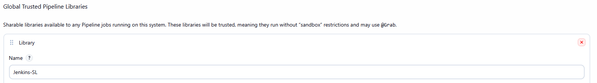

# Jenkins Shared Library

Hands-on follow-along project from Module 8 of the DevOps Bootcamp. Builds on `02-ci-pipeline-with-jenkinsfile`; moves the build and Docker logic out of the project repository into a separate shared library repository and calls it from the Jenkinsfile.

## Overview

Once several projects build the same way (Maven JAR, Docker image, push to a registry), most of each Jenkinsfile is a copy of the last one. Changing the build tool or the registry then means editing every repository.

A Jenkins Shared Library is a Git repository of Groovy functions that any Jenkinsfile can import. The logic is written once and versioned on its own. My library lives at `github.com/GiovanniDevs/module8-Jenkins-SL` and is registered in Jenkins under the name **`Jenkins-SL`**. The registered name, not the repository name, is what the Jenkinsfile imports.

## Project objectives

- Create a separate Git repository for the shared library
- Write reusable functions in `vars/` and shared implementation in `src/`
- Register the library globally in Jenkins
- Call its functions from the application's Jenkinsfile, passing the image name as a parameter

## Technologies used

Jenkins, Groovy, Docker, Docker Hub, Git and GitHub, Java 17, Maven

## Implementation

### 1. Library structure

```
jenkins-shared-library/
├── vars/                       # one file per callable function
│   ├── buildJar.groovy
│   ├── buildImage.groovy
│   ├── dockerLogin.groovy
│   └── dockerPush.groovy
└── src/com/example/Docker.groovy   # shared implementation
```

Each file in `vars/` must define a `call` method, and the file name becomes the function name in the Jenkinsfile: `buildJar.groovy` is called as `buildJar()`. Functions in `vars/` have the pipeline context so: `sh`, `echo`, `withCredentials` and the environment variables all work directly.

```groovy
#!/user/bin/env groovy

def call() {
    echo "building the application for branch $GIT_BRANCH"
    sh 'mvn package'
}
```

### 2. Shared implementation in `src/`

The three Docker functions all need the same credentials and the same patterns, so the implementation sits in one class instead of being repeated three times. A class under `src/` is plain Groovy and knows nothing about Jenkins, so the pipeline context is handed to it as a `script` object and every pipeline call is prefixed with `script.`:

```groovy
#!/user/bin/env groovy
package com.example

class Docker implements Serializable {

    def script

    Docker(script) {
        this.script = script
    }

    def buildDockerImage(String imageName) {
        script.echo 'building the docker image...'
        script.sh "docker build -t $imageName ."
    }

    def dockerLogin() {
        script.withCredentials([script.usernamePassword(credentialsId: 'dockerhub-credentials', passwordVariable: 'PASS', usernameVariable: 'USER')]) {
            script.sh "echo ${script.PASS} | docker login -u ${script.USER} --password-stdin"
        }
    }

    def dockerPush(String imageName) {
        script.sh "docker push $imageName"
    }
}
```

`implements Serializable` lets Jenkins save and restore pipeline state if a build is paused and resumed. The `vars/` files are thin wrappers that pass `this` as the context:

```groovy
#!/user/bin/env groovy
import com.example.Docker

def call(String imageName) {
    return new Docker(this).buildDockerImage(imageName)
}
```

Keeping `vars/` as the public interface and `src/` as the implementation means a consumer's Jenkinsfile never has to change when the internals do.

### 3. Register the library in Jenkins

Manage Jenkins → System → **Global Pipeline Libraries**, with the name `Jenkins-SL`, the repository URL and credentials, and a default version. Registering it globally makes it available to every pipeline on the instance. A library can instead be declared inside a single Jenkinsfile with the `library()` method and a `modernSCM` retriever, which suits a library only one or two projects need.

Choosing the default version is an important decision. If it points to a branch, every commit to that branch is immediately used by every pipeline, meaning one bad commit can break them all. For a library shared across many projects, a tag or commit hash is the safer choice.



### 4. Call it from the Jenkinsfile

```groovy
#!/user/bin/env groovy

// library name from jenkins system settings
@Library('Jenkins-SL')

def gv

pipeline {
    agent any
    tools {
        maven 'maven-3.9'   // must match Manage Jenkins → Tools exactly
    }

    stages {
        stage('init') {
            steps { script { gv = load 'script.groovy' } }
        }
        stage('build jar') {
            steps { script { buildJar() } }
        }
        stage('build and push image') {
            steps {
                script {
                    buildImage 'giovannidevs/demo-app:jma-2.0'
                    dockerLogin()
                    dockerPush 'giovannidevs/demo-app:jma-2.0'
                }
            }
        }
        stage('Deploy') {
            steps { script { gv.deployApp() } }
        }
    }
}
```

Two details are worth noting. The library name in `@Library` is the name registered in Jenkins, which is not the same as the GitHub repository name. And the project keeps its own `script.groovy` for `deployApp()`, because a shared library replaces the common logic, not everything.

Splitting build, login and push into three functions rather than one gives finer control and shows each operation separately in the build log.

## Verification

- The build log shows the library being loaded before the first stage runs
- `buildJar()` produces the JAR, and the build, login and push steps appear as distinct operations in the log
- The tag pushed by the pipeline appears in `giovannidevs/demo-app` on Docker Hub
- Changing a function in the library repository changes the next build's behaviour without any edit to the application repository

## Key learnings

- File name equals function name, and every `vars/` file needs a `call` method.
- Classes under `src/` have no Jenkins context; passing `this` as a `script` object is what makes `sh`, `echo` and `withCredentials` usable from them
- Groovy interpolates variables only inside double quotes; single quotes make `${imageName}` a literal string, which fails in a way that looks like a Docker error rather than a Groovy one
- Parameterising functions is what makes them reusable. A hardcoded image name limits the library to one project
- Versioning the library by tag protects every consumer from a bad commit
- `@Library` is a Groovy annotation and must be attached to a declaration: an `import`, a `def` variable, or a placeholder `_`. In this Jenkinsfile it works because `def gv` follows it, but that is fragile, so `@Library('Jenkins-SL')_` is the safer form. Without any of these directly above `pipeline {`, the Jenkinsfile fails to compile

## Project structure

```
03-jenkins-shared-library/
├── README.md
├── Jenkinsfile                          # consumer side, from the jenkins-shared-lib branch
└── jenkins-shared-library/              # copy of github.com/GiovanniDevs/module8-Jenkins-SL
    ├── vars/
    │   ├── buildJar.groovy
    │   ├── buildImage.groovy
    │   ├── dockerLogin.groovy
    │   └── dockerPush.groovy
    └── src/com/example/Docker.groovy
```

The library is a standalone repository, which is what makes it shareable. The copy here exists so this project can be read on its own.
