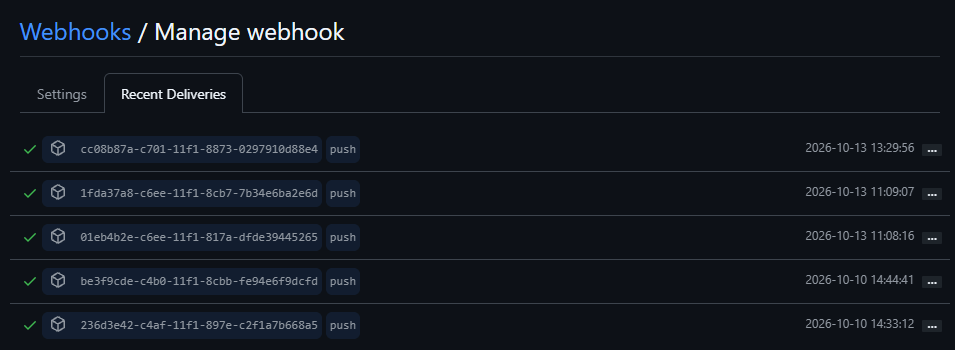

# Trigger the CI Pipeline Automatically with a Webhook

Hands-on follow-along project from Module 8 of the DevOps Bootcamp. Builds on `02-ci-pipeline-with-jenkinsfile`; replaces manual _Build Now_ with a push-triggered build. The lectures use GitLab; my repositories are on GitHub, so this project is the GitHub equivalent of the lesson, worked out and tested against my own server.

## Overview

Continuous integration is not continuous if someone has to press a button. The repository needs to tell Jenkins that something changed, which means configuring both sides: Jenkins has to be able to reach the GitHub API, and GitHub has to know where to send a push event.

Two mechanisms were needed, because they are genuinely different. A regular pipeline job is triggered through the GitHub plugin and a repository webhook. A multibranch pipeline cannot use that plugin at all, and instead needs the provider-neutral Multibranch Scan Webhook Trigger plugin with a token.

Manual and scheduled triggers were not replaced for everything: manual still makes sense for production deployment, and a schedule suits long test suites that would overload the server if run on every commit.

## Project objectives

- Connect Jenkins to the GitHub API with a personal access token
- Trigger a regular pipeline job on every push
- Trigger a multibranch pipeline scan on every push
- Verify the trigger from both ends, with a real commit

## Technologies used

Jenkins, GitHub, Git, Docker, Java 17, Maven

## Implementation

### 1. GitHub personal access token

Created under Settings → Developer settings → Personal access tokens (classic), with a far-off expiry and two scopes:

- `admin:org_hook`, required by the GitHub plugin to manage hooks. This is the scope that made it work.
- `repo`, read and write access to the repository.

GitHub shows the token once. It is used twice in Jenkins, as two different credentials that are not interchangeable: a **Secret text** credential for the GitHub server connection, and a **Username with password** credential (token as the password) for cloning the repository in Source Code Management.

### 2. GitHub server connection in Jenkins

Manage Jenkins → System → GitHub → **Add GitHub Server**:

- Name: anything descriptive
- API URL: the default `https://api.github.com`. This is the API host, not the website, and only changes for GitHub Enterprise
- Credentials: the Secret text credential holding the token
- **Test connection** prints the GitHub login name, which confirms Jenkins can reach the API

This is the GitHub counterpart of the lecture's GitLab connection. One difference worth recording: the GitLab plugin adds a dedicated "GitLab API token" credential kind, while the GitHub plugin just uses plain Secret text.

### 3. Trigger a regular pipeline job

In the job: **Build Triggers → GitHub hook trigger for GITScm polling**.

There is no per-job GitHub connection dropdown, because the server configuration is global. Jenkins decides which job to build by comparing the repository in the incoming push against each job's Source Code Management repository URL, so that URL has to be the GitHub repository URL. Without the checkbox ticked the webhook still returns `200` and nothing builds, which is a confusing failure mode.

Then in the repository: Settings → **Webhooks → Add webhook**

- Payload URL: `http://<jenkins-ip>:8080/github-webhook/`, and the trailing slash is required
- Content type: `application/json`
- Events: just the push event

Unlike GitLab, the job name does not appear in the URL: it is one endpoint for the whole instance. There are no Jenkins username and password fields either. GitLab's integration logs in to Jenkins, while the GitHub webhook simply posts to an endpoint that accepts the call.

### 4. Trigger a multibranch pipeline

The GitHub trigger does not cover multibranch pipelines, exactly as the GitLab plugin does not. The lesson's solution is provider-neutral, so it applies to GitHub unchanged:

1. Install **Multibranch Scan Webhook Trigger** from Manage Jenkins → Plugins
2. In the multibranch job: Configure → **Scan Multibranch Pipeline Triggers** → tick **Scan by webhook** and set a **Trigger token**, any invented string, which acts as the shared secret. No system-level configuration is needed
3. Add a second repository webhook with the payload URL:

```
http://<jenkins-ip>:8080/multibranch-webhook-trigger/invoke?token=<trigger-token>
```

On a push, GitHub calls that URL, Jenkins finds the multibranch pipeline configured with that token, scans it, and builds the branch that changed.

Saving a multibranch job always triggers a scan on its own, so the first build after saving is not yet proof that the webhook works.

## Verification

- **Recent Deliveries** on the GitHub webhook shows the push payload and a `200` response, which is the GitHub equivalent of GitLab's "Test settings" button
- A commit pushed to the `testing-hook` branch started a build within seconds, with no manual trigger
- The change made in that commit is visible in the build log, confirming Jenkins built the new commit and not a cached checkout




## Key learnings

- Following a lesson on a different platform is its own exercise: the concepts carried over exactly, but almost every screen and endpoint differed, and the token scopes had no one-to-one equivalent
- A webhook returning `200` does not mean a build ran. The trigger checkbox in the job is a separate requirement
- The GitHub endpoint is instance-wide and matches jobs by repository URL; the GitLab one is job-specific. That changes how you debug a trigger that does not fire
- Multibranch pipelines need a separate, provider-neutral trigger mechanism, and the token in the URL is the only thing linking the webhook to the job
- A public address is unavoidable: no webhook provider can reach `localhost`

## Project structure

```
04-webhook-trigger-ci-pipeline/
├── README.md
└── Jenkinsfile    # simplified pipeline used to prove the trigger fired, from the testing-hook branch
```

The webhook and plugin configuration lives in Jenkins and GitHub, not in the repository, so there is nothing else to commit.
